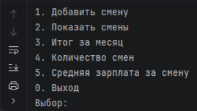
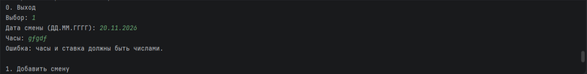

# Калькулятор смен и зарплаты

Консольное приложение на Python для учёта рабочих смен и расчёта заработной платы.  
Сделано для личного использования: работаю суточными сменами, нужно считать итоговую сумму за месяц.

## Версии
- **v1.0** — базовый калькулятор без сохранения данных (список в памяти)

## Возможности (v1.0)
- Добавление смены: дата, часы, ставка
- Просмотр всех смен
- Расчёт итоговой суммы за месяц
- Подсчёт количества смен
- Средняя зарплата за смену
- Обработка ошибок ввода (буквы вместо чисел не ломают программу)

## Скриншоты

### Версия 1.0 (без JSON)

**Главное меню программы:**


**Добавление новой смены:**


**Просмотр списка смен:**


**Обработка ошибок ввода (защита от падения программы):**


## Стек
- Python 3.15+
- Стандартная библиотека

## Установка и запуск
```bash
git clone https://github.com/username/shift-calculator.git
cd shift-calculator
python main.py
