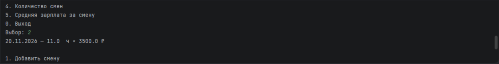
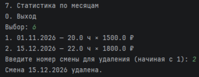
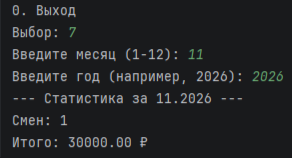
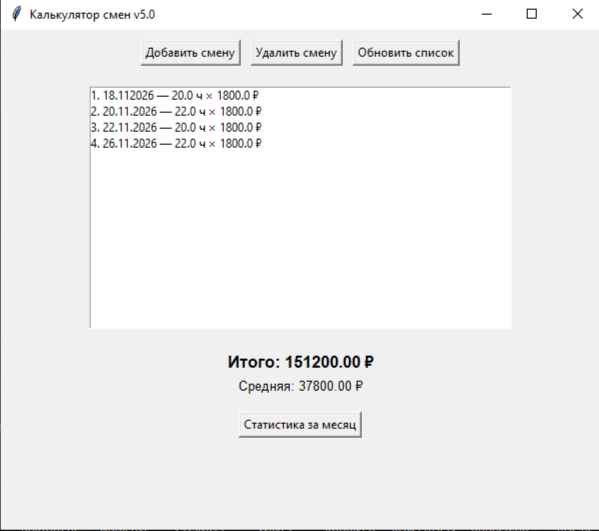
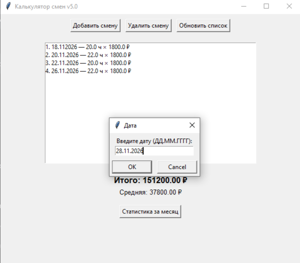

# Калькулятор смен и зарплаты

Консольное приложение на Python для учёта рабочих смен и расчёта заработной платы.  
Сделано для личного использования: работаю суточными сменами, нужно считать итоговую сумму за месяц.

## Версии
- **v1.0** — базовый калькулятор без сохранения данных
- **v2.0** — добавлено сохранение смен в JSON
- **v3.0** — добавлено удаление смен и статистика по месяцам
- **v4.0** — рефакторинг (разделение на модули), удаление смен, статистика по месяцам
- **v5.0** — добавлен графический интерфейс (Tkinter)

## Возможности
- Добавление смены: дата, часы, ставка
- Просмотр всех смен
- Удаление смены по номеру
- Расчёт итоговой суммы за месяц
- Подсчёт количества смен
- Средняя зарплата за смену
- Статистика за конкретный месяц и год
- Сохранение данных в файл и загрузка при старте (JSON)
- Обработка ошибок ввода

## Скриншоты
### Версия 1.0 (без JSON)

**Главное меню программы:**


**Добавление новой смены:**


**Просмотр списка смен:**


**Обработка ошибок ввода (защита от падения программы):**


### Версия 2.0 (с JSON)

**Сохранение смены (данные записываются в файл):**


**Файл `shifts.json` с сохраненными данными:**


### Версия 3.0 (удаление и статистика)

**Удаление смены по номеру:**


**Статистика за конкретный месяц:**


### Версия 5.0 (графический интерфейс)

**Главное окно программы:**


**Добавление новой смены через диалоговое окно:**


## Структура проекта
```text
Shift-Calculator/
├── main.py          # Консольная версия (v1-v4)
├── gui.py           # Графическая версия (v5)
├── storage.py       # Работа с JSON файлом
├── logic.py         # Расчеты и логика
├── README.md        # Описание проекта
├── CHANGELOG.md     # История версий
├── .gitignore       # Исключения для Git
└── screenshots/     # Скриншоты работы
```

## Стек
- Python 3.15+
- Стандартная библиотека

## Установка и запуск
```bash
git clone https://github.com/Ramzesoff/Shift-Calculator.git
cd Shift-Calculator

# Для запуска консольной версии:
python main.py

# Для запуска графической версии:
python gui.py
```

## Чему я научился
- Работа с функциями и возвратом значений (`return`)
- Списки словарей для хранения структурированных данных
- Обработка исключений (`try/except ValueError`) для защиты от падения программы
- Сохранение и загрузка данных в формате JSON (`json.dump`, `json.load`)
- Работа с файловой системой через модуль `os`
- Рефакторинг: разделение кода на модули (`storage.py`, `logic.py`) и работа с импортами
- Работа с Git и GitHub (коммиты, загрузка файлов)
- Создание графического интерфейса (GUI) с помощью библиотеки tkinter
