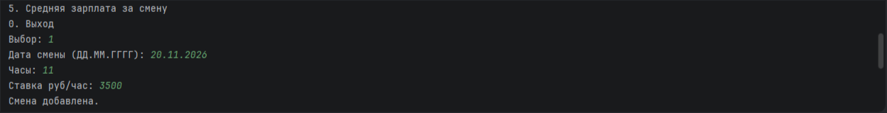
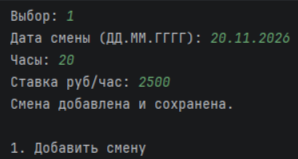
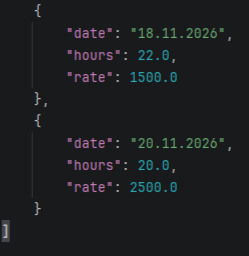

# Калькулятор смен и зарплаты

Консольное приложение на Python для учёта рабочих смен и расчёта заработной платы.  
Сделано для личного использования: работаю суточными сменами, нужно считать итоговую сумму за месяц.

## Версии
- **v1.0** — базовый калькулятор без сохранения данных (список в памяти)
- **v2.0** — добавлено сохранение смен в JSON (данные не теряются между запусками)
- **v3.0** — добавлено удаление смен и статистика по месяцам

## Возможности
- Добавление смены: дата, часы, ставка
- Просмотр всех смен
- Удаление смены по номеру
- Расчёт итоговой суммы за месяц
- Подсчёт количества смен
- Средняя зарплата за смену
- Статистика за конкретный месяц и год
- Сохранение данных в файл и загрузка при старте (JSON)
- Обработка ошибок ввода (буквы вместо чисел не ломают программу)

## Скриншоты

### Версия 1.0 (без JSON)

**Главное меню программы:**


**Добавление новой смены:**


**Просмотр списка смен:**


**Обработка ошибок ввода (защита от падения программы):**


### Версия 2.0 (с JSON)

**Сохранение смены (данные записываются в файл):**


**Файл `shifts.json` с сохраненными данными:**


### Версия 3.0 (удаление и статистика)

**Удаление смены по номеру:**


**Статистика за конкретный месяц:**


## Структура проекта
```text
Shift-Calculator/
├── main.py          # весь код: меню, функции, расчёты
├── README.md        # описание проекта
├── CHANGELOG.md     # история версий
├── .gitignore       # исключения для Git
└── screenshots/     # скриншоты работы
    ├── v1_menu.png
    ├── v1_add_shift.png
    ├── v1_show_shifts.png
    ├── v1_error_handling.png
    ├── v2_add_shift.png
    ├── v2_json_file.png
    ├── v3_delete_shift.png
    └── v3_monthly_stats.png
```

## Стек
- Python 3.15+
- Стандартная библиотека

## Установка и запуск
```bash
git clone https://github.com/Ramzesoff/Shift-Calculator.git
cd Shift-Calculator
python main.py
